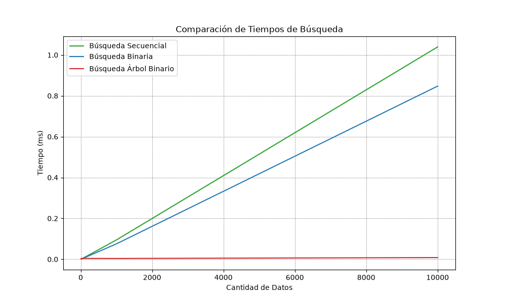

# Análisis TP3 — Árbol Binario de Búsqueda
## 1. ¿Qué resolvimos?
Incorporamos un **árbol binario de búsqueda (BST)** para resolver la búsqueda del nombre del manga de forma más eficiente.

## 2. Clave de ordenamiento
Lo primero que uno va a corroborar es si el manga que conoce está, así que es la primera función a la que uno se tienta a probar.

## 3. Prueba del árbol
Salida de
`python algoritmos/probar_bst.py`

```
Altura del árbol: 3

--- Inorder (ordenado alfabéticamente) ---
  
  - Berserk(rating9.24)
  - Claymore(rating8.39)
  - Erased(rating8.52)
  - Rurouni Kenshin(rating8.72)
  - Vagabond(rating8.86)

--- Preorder ---
  
  - Erased
  - Claymore
  - Berserk
  - Vagabond
  - Rurouni Kenshin

--- Postorder ---
  
  - Berserk
  - Claymore
  - Rurouni Kenshin
  - Vagabond
  - Erased

--- Búsquedas ---

- Buscar 'rurouni kenshin': Rurouni Kenshin(rating8.72)
- Buscar 'zzz': None

```

## 4. Comparación de tiempos
En la tabla siguiente, los tiempos son **reales**, sacados con nuestro script `algoritmos/medicionTP3.py`

```
| Tamaño de la Muestra | Búsqueda secuencial (ms) | Búsqueda binaria (ms) | Árbol binario (ms) |
|----------------------|--------------------------|-----------------------|--------------------|
| 10                   | 0.0009                   | 0.0008                | 0.0036             |
| 100                  | 0.0086                   | 0.0070                | 0.0041             |
| 1000                 | 0.0944                   | 0.0752                | 0.0038             |
| 10000                | 1.0391                   | 0.8473                | 0.0081             |
```


## 5. Análisis de complejidad


| Estrategia                         | Peor Caso O()        | Mejor Caso Ω()         | Caso Típico O() (listas chicas)          |
|------------------------------------|----------------------|-----------------------|------------------------------------------|
| Secuencial (buscar)                | O(n)                 | Ω(1) (está primero)    | Proporcional a n/2 promedio O(log n)     |
| Binaria (buscar_binaria)           | O(log n)             | Ω(1)                   | O(log n)                                 |
| Ordenar antes de binaria (una vez) | O (n log n)          | Ω(n log n)             | Se ordena la primera vez y después ya no |
| Árbol Binario (insertar)           | O(n) (árbol degenerado) | Ω(1)                   | O(log n)                                 |
| Árbol Binario (buscar)             | O(n) (árbol degenerado) | Ω(1) (está en la raíz) | (O(logn)                                 |
| Árbol Binario (recorridos)         | O(n)                 | Ω(n)                   | O(n)                                     |


## 6. Conclusión

Si tenemos que elegir me quedo con el Árbol Binario para la búsqueda.
Si vemos la tabla está claro que es mucho más eficiente que los demás llegando a 0.008 ms superando en velocidad a los otros dos. Claro que tiene sus desventajas, como ser el tiempo que toma el cargar los elementos en cada nodo y el costo extra que producen los punteros, pero una vez armado los beneficios superan estas desventajas y por eso se lo elige.

## 7. Errores o dudas que tuvimos

- En el proceso de medición de la búsqueda lineal, la binaria y el árbol estuve mucho tiempo tratando de entender qué error tenía cuando tocaba medir los 1000 y 10000 elementos del dataset. Antes de perder más tiempo consulté a la IA sólo para darme cuenta que no tenía que medir el árbol al final sino al principio, antes de que la lista se ordenara, sino iba a tener un árbol de una sola rama ordenado, y como no es un AVL éste no se puede ordenar por sí solo. Poniendo el "ordenar_por_nombre" después del cálculo del árbol pude correrlo sin problemas.