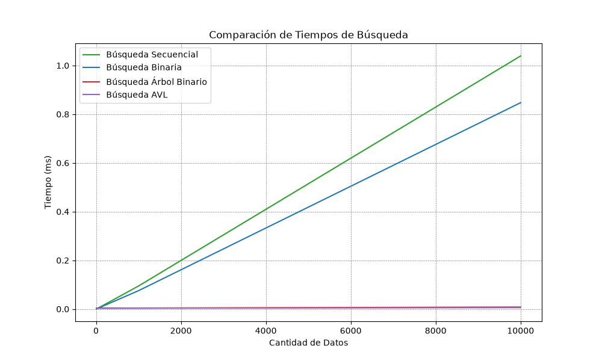

# Análisis TP4 y TP5 — AVL y árbol general (N-ario)
## 1. ¿Qué resolvimos?
Se incorporó el método AVL que permite balancear el árbol cuando un árbol empieza a degerarse (una de sus ramas se empieza a desequilibrar) y el árbol general nos agrupa de forma jerárquica los géneros de los mangas y permite que se reocrra de manera más sencilla los subárboles (subcategorías).

## 2. Clave de ordenamiento
"Para el AVL la clave de posicionamiento viene dada por el atributo que se le da al árbol para que decida, en base a eso, para dónde girar o para dónde enviar un dato (izqueirda o derecha), mientras que el del árbol general está definida por la jerarquía."

## 3. Prueba del árbol
Salida de
`python estructuras/avl.py`

```
=== AVL con datos ordenados ===
Altura del AVL: 4
Cantidad de nodos: 10

--- inorder ---
  20th Century Boys(7)
  Akira(9)
  Berserk(1)
  Fullmetal Alchemist(8)
  JoJo's Bizarre Adventure(4)
  Monster(2)
  Nausicaa(3)
  Vinland Saga(5)
  Yokohama Kaidashi Kikou(6)
  Yotsuba&!(10)

--- preorder (muestra el balance) ---
  Monster(2)
  Berserk(1)
  20th Century Boys(7)
  Akira(9)
  JoJo's Bizarre Adventure(4)
  Fullmetal Alchemist(8)
  Vinland Saga(5)
  Nausicaa(3)
  Yokohama Kaidashi Kikou(6)
  Yotsuba&!(10)

Buscar 'Yokohama Kaidashi Kikou': Yokohama Kaidashi Kikou(6)
Buscar 'Sailor Moon': None

=== Comparación BST vs AVL ===
  Altura BST: 6
  Altura AVL: 4
  BST es más alto que AVL: True

```

## 4. Comparación de tiempos
En la tabla siguiente, los tiempos son **reales**, sacados con nuestro script `algoritmos/medicionTP4y5.py`

```
| Tamaño de la Muestra | Búsqueda secuencial (ms) | Búsqueda binaria (ms) | Árbol binario (ms) | AVL (ms) |
|----------------------|--------------------------|-----------------------|--------------------|----------|
| 10                   | 0.0009                   | 0.0008                | 0.0041             | 0.0031   |
| 100                  | 0.0087                   | 0.0066                | 0.0036             | 0.0026   |
| 1000                 | 0.0941                   | 0.0744                | 0.0026             | 0.0033   |
| 10000                | 0.8412                   | 0.5670                | 0.0107             | 0.0057   |
```


## 5. Análisis de complejidad

| Estrategia                         | Peor Caso O()        | Mejor Caso ()         | Caso Típico O() (listas chicas)          |
|------------------------------------|----------------------|-----------------------|------------------------------------------|
| Secuencial (buscar)                | O(n)                 | Ω(1)                  | Proporcional a n/2 promedio O(log n)     |
| Binaria (buscar_binaria)           | O(log n)             | Ω(1)                  | O(log n)                                 |
| Ordenar antes de binaria (una vez) | O (n log n)          | Ω(n log n)            | Se ordena la primera vez y después ya no |
| Árbol Binario (insertar)           | O(n) (árbol enfermo) | Ω(1)                  | O(log n)                                 |
| Árbol Binario (buscar)             | O(n) (árbol enfermo) | (1) (está en la raíz) | O(logn)                                  |
| Árbol Binario (recorridos)         | O(n)                 | (n)                   | O(n)                                     |
| Árbol AVL (insertar)               | O(log n)             | Ω(1)                  | O(log n)                                 |
| Árbol AVL (buscar)                 | O(log n)             | Ω(1)                  | O(log n)                                 |
| Árbol AVL (recorridos)             | O(n)                 | Ω(n)                  | O(n)                                     |


## 6. Conclusión
Vemos que la gran diferencia entre árbol binario y AVL es que mientras el árbol binario puede degenerarse si los datos entran ordenados, comportándose al final como una búsqueda lineal, eso no pasa con el AVL que se autobalancea.
Por otro lado el árbol general nos ayuda a organizar la información de forma jerárquica. En nuestro caso podemos tener subcategorías de géneros de mangas y que no tienen que ser estrictamente en 2 o menos hijos.

## 7. Errores o dudas que tuvimos

- Creo que mi AVL termina comportándose como una lista enlazada ya que cree una función para que la búsqueda de los nombres de los mangas puedan basarse en una palabra, sin importar si esa palabra está en el medio o al final del nombre. Para poder devolver resultados tiene que recorrer si o si todos los nodos buscando en cada uno de ellos una coincidencia. De haberla, crearía una lista con todos los nobmres que contengan esa palabra. La búsqueda se completa y da todos los resultados posibles, pero la optimización en la búsqueda usando AVL creo que no se cumple. 