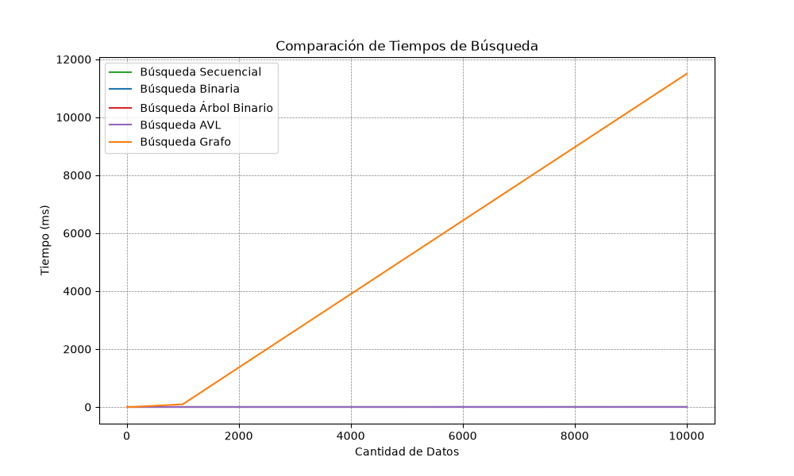

# Análisis TP6 — Grafos y BFS
## 1. ¿Qué resolvimos?
Se agregó al sistema de recomendación los **Grafos No Dirigidos** que hace posible las conexiones entre mangas basándose en características que tienen en común, como género, artista y año.
Nuevamente resolvemos el tema de la búsqueda del nombre del manga con el que vamos a compar a los demás usando la función de `buscar_palabra`.
Para evitar que nuestro manga base esté entre las opciones de recomendación usamos `w != inicio` en el recorrido de anchura (BFS).

## 2. Clave de ordenamiento
Se usó un orden jerárquico de prioridades para que se mostraran primero los mangas relacionados entre sí por el mismo **artista**, luego seguía el **año** y por último el **género** (ya que a éste lo usamos anteriormente como protagonista en la `Recomendación por Género`).

## 3. Prueba del grafo

* Se elije la opción 4 del menú y se escribe el nombre o una palabra que esté en el nombre del manga base con el que se van a comparar los demás mangas.


* Nos devuelve una lista con las recomendaciones donde figuran el nombre de los mangas recomendados, sus géneros y año.


* Si vamos al dataset podemos ver que los primeros resultados de las recomendaciones son de la similitud que tienen los mangas con el artista.


## 4. Comparación de tiempos
En la tabla siguiente, los tiempos son **reales**, sacados con nuestro script `algoritmos/medicionTP4y5.py`

```
|   | Tamaño de la Muestra   | Búsqueda secuencial (ms)   | Búsqueda binaria (ms)   | Árbol binario (ms)   | Grafos (ms)          |
|---|------------------------|----------------------------|-------------------------|----------------------|----------------------|
|   | ---------------------- | -------------------------- | ----------------------- | -------------------- | -------------------- |
|   | 10                     | 0.0009                     | 0.0008                  | 0.0036               | 0.0439               |
|   | 100                    | 0.0086                     | 0.0070                  | 0.0041               | 0.9210               |
|   | 1000                   | 0.0944                     | 0.0752                  | 0.0038               | 92.8245              |
|   | 10000                  | 1.0391                     | 0.8473                  | 0.0081               | 11497.5312           |
```


## 5. Análisis de complejidad

```
| Estrategia                              | Peor Caso O() | Mejor Caso () | Caso Típico O() (listas chicas)                   |
|-----------------------------------------|---------------|---------------|---------------------------------------------------|
| Búsqueda Inicial(buscar_palabra lineal) | O(n)          | O(1)          | O(n)                                              |
| Construir el Grafo (AdminGrafos)        | O(n^2)        | O(n^2)        | O(n^2)(comparación con iguales)                   |
| Recorrido BFS(bfs_recomendaciones)      | O (v+e)       | O(1)          | O(v + e) (visita a vértices y aristas accesibles) |
| Ordenamiento por Prioridad(.sort())     | O(n log n)    | O(n)          | O(n log n)                                        |
```

## 6. Conclusión
- El uso de los grafos sumado al BFS es la combinación más ideal para usar en la opción 4 donde el principal tema es la relación de similitudes entre un manga base y los mangas que compartan el mismo artista, año y género. Si bien también se podría haber usado el DFS, preferí dejarlo para combinarlo al final junto con el Heap.
- El ordenamiento por jerarquías me pareció la manera más justa para darle su protagonismo a cada dato de los mangas con los que contábamos.
- Viendo el comportamiento de los grafos en la tabla de comparacion de tiempo, al principio me llamó la atención el resultado dado cuando trabajábamos con 10.000 elementos pero después se hizo comprensible al entender que ese comportamiento se da una sola vez, cuando se crea toda la red de adyacencias comparando los elementos, por lo que se entiende que cuanto más aristas tenga para comparar mayor va a ser ese salto con respecto a los valores anteriores de la tabla.

## 7. Errores o dudas que tuvimos

- Uno de los errores que tuve, y lo solucioné de una manera que a mi parecer se ve muy plana (pero funciona), fue cuando se recomendaba el mismo manga que se usaba de base para comparar con otros. La solución fue hacer un `w !=inicio` en el algoritmo BFS.
- Otro de los errores, que esta vez pude solucionar gracias a la IA, fue que las búsquedas por BFS no eran tan profundas así que tuve que aumentar el radio para que mangas que compartían el mismo artista pudieran salir en la lista de recomendaciones.