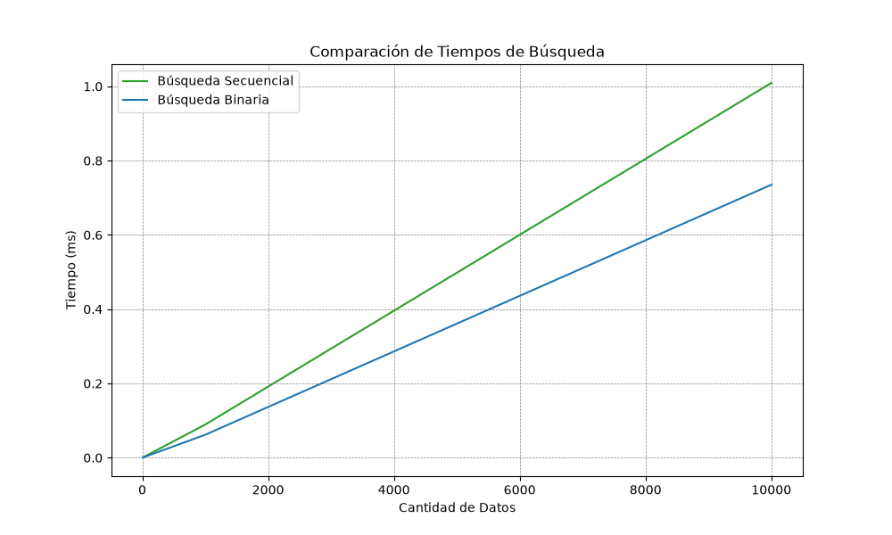

# TP2 — Análisis de complejidad

## 1. Operación crítica elegida
Se eligió "Búsqueda por nombre" porque es lo que más se recuerda en un manga y con el que se guián a la hora de buscar información.

## 2. Estrategias comparadas
| ID | Estrategia | Implementación |
|---|---|---|
| A | Secuencial | `Catalogo.buscar` (TP1) |
| B | Binaria | `Catalogo.buscar_binaria` (`bisect`, lista ordenada) |

## 3. Datos de prueba
> Datasets sintéticos de 100, 1.000 y 10.000 elementos.
> Generador: `datos/generar.py`.

## 4. Método de medición
> Usé `timeit` al cual le di instrucciones de hacer 20 ejecuciones x 5 repeticiones.
> Se elije el de mener tiempo para evitar interferencias del sistema operativo o proceso en segundo plano.
> Script usado: `algoritmos/experimentos/medicion.py`.

## 5. Resultados

| Tamaño de la Muestra | Búsqueda secuencial (ms) | Búsqueda binaria (ms) |
|----------------------|--------------------------|-----------------------|
| 10                   | 0.0010                   | 0.0008                |
| 100                  | 0.0088                   | 0.0061                |
| 1000                 | 0.0892                   | 0.0618                |
| 10000                | 1.0093                   | 0.7352                |

## 6. Análisis de complejidad
| Estrategia                         | Peor caso O() | Mejor caso Ω()      | Caso típico Θ() (listas chicas) |
|------------------------------------|---------------|---------------------|---------------------------------|
| Secuencial (buscar)                | O(n)          | Ω(1) (está primero) | Proporcional a n/2 promedio     |
| Binaria (buscar_binaria)           | O(log n)      | Ω(1)                | Θ(log n)                        |
| Ordenar antes de binaria (una vez) | O(n log n)    | Ω(n log n)          | Pagado una vez, amortizado      |

### Análisis teórico
La búsqueda secuencial recorre la lista de manera secuencial (de ahí su nombre) hasta encontrar lo que le indicaron. En el peor de los casos revisa el máximo de los elementos y por eso tiene un crecimiento lineal O(n).
La búsqueda binaria (siempre que esté ordenada la lista) divide a la mitad la lista en cada vuelta haciendo, como mucho, log2(n) comparaciones O(log n). Si sumamos el costo de tener la lista ordenada al principio tenemos O(n log n) al acomodar el catálogo.

## 7. Conclusión

1. Qué se comparó?: tomamos la misma operación crítica que era la de buscar un manta por su nombre, en condiciones iguales de entorno y con la misma cantidad de datos, enfrentando la búsqueda lineal (secuencial) contra una logarítmica (binaria).
2. Qué dice la tabla?: Nos muestra que cuando el tamaño de los datos crece el tiempo de la búsqueda secuencial se multiplica proporcionalmente.En cambio, el crecimiento de la búsqueda binaria muestra un crecimiento míniom y más eficiente.
3. Por qué?: Esto pasa proque el recorrido lineal depende directamente de la cantidad total del arreglo (O(n)) y el algoritmo de división binaria achica la cantidad de tareas al hacer la partición logarítmica (O(log n)).
4. Cuál conviene y por qué?: Para catálogos grandes la búsqueda binaria sirve cuando se hace la misma búsqueda más de una vez ya que en la primera vez se acomoda el catálogo y después de esa primera vez ya queda acomodado. Al hacer esa partición al medio reduce rapidamente el tamaño del catálogo. Por esa razones es la opción más óptima. Pero para listas más chicas o donde cueste mucho mantener un orden la más indicada es la estrategia secuencial.
5. Qué se aprende del experimento?: Con pocos elementos no hay diferencias entre los dos métodos, pero a medida que van creciendo (especialmente después de los 100 elemenetos) la cosa empieza a cambiar y vemos que la opción logarítmica empieza a mostrar su superioridad por sobre la secuencial.